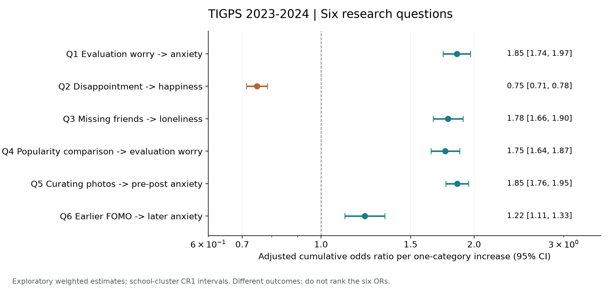
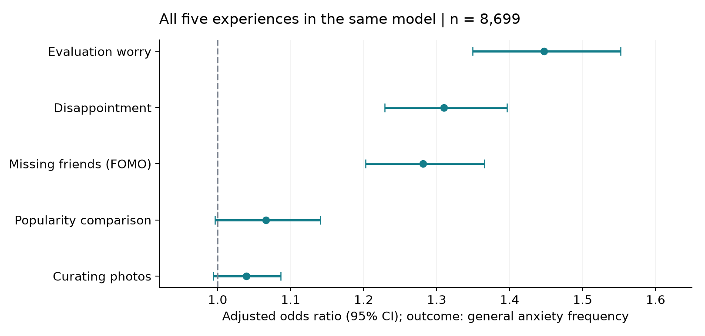

# 社群媒體上的哪些感受，與青少年的心理健康有關？

TIGPS 2023–2024｜六個議題與多角色跨檔分析｜2026-11-05

## 研究摘要

本次重新讀取第一波六類對象及第二波學生的原始 Stata 檔，共七組資料，並讀取兩波資料使用說明、官方問卷、編碼簿與手冊。第一至五題以第二波為主，第六題以學生 ID 連結兩波。既有 `research_output/研究報告.md` 保留作前次稽核紀錄；本報告另行完成實際描述統計、模型估計與跨檔擴充。

**主要發現：**擔心被批評與較頻繁緊張焦慮、更新狀態無回應的失望與較低快樂感、錯過朋友聚會的困擾與較多寂寞，均有關聯。比較受歡迎程度與評價擔憂、挑選好看照片與發布前焦慮也有正向關聯。控制第一波焦慮後，第一波怕錯過與第二波焦慮仍有較小的正向關聯。

**證據範圍：**以下為依釋出權重計算的探索性關聯，使用學校群集穩健標準誤，尚非經官方 JRR 校驗的全台母體推論；第六題也尚未校正題本選擇及縱貫流失。結果不能解釋為社群媒體造成心理疾病。所有主要檢定的顯著性都以本報告的近似誤差模型為條件。

## 六題結果總表

| 議題 | 實際變項 | 有效 n／學校數 | 調整後 OR（95% CI） | Holm 校正 p |
| --- | --- | --- | --- | --- |
| 1. 擔心被評價 → 緊張焦慮 | bs24b → bs56m | 8,747／178 | 1.85（1.74–1.97） | <.001 |
| 2. 社群失望 → 快樂感 | bs24c → bs51 | 8,762／178 | 0.75（0.71–0.78） | <.001 |
| 3. 怕錯過朋友 → 寂寞 | bs27b → bs56l | 8,748／178 | 1.78（1.66–1.90） | <.001 |
| 4. 網路比較 → 評價擔憂 | bs26c → bs24b | 8,792／178 | 1.75（1.64–1.87） | <.001 |
| 5. 經營形象 → 發布前焦慮 | bs23b → bs24f | 8,805／178 | 1.85（1.76–1.95） | <.001 |
| 6. 先前怕錯過 → 後期緊張焦慮 | as39b → bs56m | 4,122／162 | 1.22（1.11–1.33） | <.001 |

OR 表示暴露題每增加一個作答等級，結果落在較高等級的累積勝算比；不是機率比，也不是增加幾成的人得病。第 2 題結果高分代表「更快樂」，因此 OR < 1 是快樂感較低。六題結果不同，不能把 OR 大小直接排成心理健康影響排行榜。



## 一、研究問題、資料來源與分析對象

建議研究題目為：**「社群媒體中的評價擔憂、互動失望與錯失恐懼，與國中生焦慮、寂寞及幸福感的關聯：TIGPS 2023–2024 多來源追蹤資料分析」**。

核心研究問題拆成三層：第一，哪些社群感受與一般心理感受相關（第 1–3 題）；第二，哪些社群行為與社群情境中的焦慮相關（第 4–5 題）；第三，先前社群感受能否提供後續焦慮的額外預測資訊（第 6 題）。第 4、5 題是心理社會經驗的關聯，不能直接等同精神疾病風險。

第一波手冊界定母群為 111 學年度入學的七年級世代，採兩階段分層叢集抽樣（學校、班級）。本研究問卷檔第一波有 179 校、345 班；第二波有 178 校、343 班。第一波調查含課堂主問卷及後續附加問卷，資料使用說明列整體期間為 2023-05-15 至 2023-09-15；第二波說明列 2024-05-20 至 2024-06-30。追蹤間隔約一年，但個人實際間隔未在本模型納入。

| 原始資料檔 | 列數 | 欄數 | 觀察單位 |
| --- | --- | --- | --- |
| TIGPSw1_s | 8,958 | 670 | 學生 |
| TIGPSw1_p | 4,495 | 563 | 照顧者紀錄 |
| TIGPSw1_f | 786 | 477 | 手足紀錄 |
| TIGPSw1_t | 242 | 259 | 班級導師 |
| TIGPSw1_st | 1,094 | 156 | 班級×科目教師紀錄 |
| TIGPSw1_sc | 175 | 138 | 學校問卷填答者 |
| TIGPSw2_s | 8,905 | 346 | 學生 |

CSV、DTA、SAV 是同一組調查的不同格式，不是三份獨立樣本。本次模型直接由 DTA 重算，讀取完整值碼；中文長題幹再回查 PDF，不依截斷的 Stata 標籤猜測。本次沒有重新逐值驗證 CSV／SAV 與 DTA 等價。根目錄既有 HTML 導覽頁未作為官方測量來源。

資料夾名稱雖是第一波，第 1、2、5 題的直接題目主要在相鄰 `wave 2 2024` 的學生問卷，因此採用兩波資料。第二波本地資料只有學生，故家庭、教師、學校皆作為第一波基期背景，不能標成第二波當期環境。

## 二、變項選擇與 codebook 對照

| 議題 | 主要暴露 | 官方題意 | 結果／基期控制 | PDF 閱讀器頁序 |
| --- | --- | --- | --- | --- |
| 1 | bs24b | 我擔心自己的言論或行為會受到批評。 | bs56m：我感到緊張焦慮。 | W2 cb 第 9–10、20 頁 |
| 2 | bs24c | 當我更新狀態而沒有人回應我時，我會感到失望。 | bs51：整體來說，你覺得最近的日子快不快樂？ | W2 cb 第 10、18 頁 |
| 3 | bs27b | 錯過和朋友們在網路上的聚會，會讓我感到很困擾。 | bs56l：我覺得很寂寞（孤單、沒伴）。 | W2 cb 第 11、20 頁 |
| 4 | bs26c | 我經常在網路上和他人比較自己受歡迎的程度。 | bs24b：擔心受到批評。 | W2 cb 第 11、9–10 頁 |
| 5 | bs23b | 我會刻意選擇自己看起來好看的照片發佈。 | bs24f：發佈任何內容之前，我都會感到焦慮。 | W2 cb 第 9、10 頁 |
| 6 | as39b | 錯過和朋友們在網路上的聚會，會讓我感到很困擾。 | W2 bs56m；基期 as72k 為控制變項。 | W1 cb 第 18–19、45 頁；W2 第 20 頁 |

所有頁碼均指 PDF 閱讀器的頁序，不是文件印刷頁碼。`as39b` 與 `bs27b` 題意相近，但第一波選項文字為「很不同意／不同意／同意／很同意」，第二波為「很不同意／不太同意／還算同意／很同意」，不把原始分數差解釋為完全等值的心理變化。

選題理由與替代操作如下：

- 評價擔憂以 bs24b 直接測量。bs24a 是自我價值依賴他人評價，bs24e 是預期真實自我遭拒絕，不能直接混成同一個已驗證量表。
- FOMO 主題選「錯過聚會感到困擾」；bs27a／as39a 自帶「焦慮」用語，只列敏感度分析，以減少暴露與結果的字面重疊。
- 比較以 bs26c 為主，另取 bs26a–c 完整三題平均。bs26d–f 偏向探索他人意見，不加入比較指標。
- 形象經營以挑選好看照片 bs23b 為主；bs23c「即使不真實也發佈形象加分訊息」另行分析，兩者不是相同行為。
- 幸福感主結果採 bs51 單題快樂，另以 bs58a–e 五題完整加總（0–20）作替代。官方選項是 0–4，不能直接套一般 WHO-5 的 0–5 計分或臨床切點。本次沒有宣稱完成量表效度驗證。

bs23／bs24 題為 1–4 的符合程度，bs26／bs27 為 1–4 的同意程度，bs51 為 1–4、越高越快樂。as72k、bs56m、bs56l 為過去 1–2 週的 0–4 頻率：0 完全沒有或少於一天；1 最近一週一到兩天；2 三到四天；3 五到七天；4 最近兩週幾乎天天。這是序位類別，不是精確天數。

### 缺失與清理

每題依上述合法集合清理；0 是症狀題合法值。負值逐碼保留至 `missing_codes.csv`，不補成 0。官方通例包含 -4 不適用、-5 不一定、-6 跳答、-7 不知道、-8 拒答、-9 系統遺漏、-99 無意義／邏輯矛盾；第一波另有 -999 此卷未答。

第一波 as39b 的 -999 為 4,221 人，另有 -9 為 53 人，合法作答 4,684 人。手冊明載該題僅 A 卷作答，且附加題本是自願續答；因此不能把這 4,221 人全當成一般隨機遺漏。本次使用逐模型完整個案，未對這種題本／續答機制進行補插或額外反應加權。五題幸福感及三題比較指標也都要求組成題完整。

## 三、描述統計

以下依 TOTWGT 算加權平均、加權描述 SD 與類別比例；分母為該題合法且權重有效的學生。SD 反映個體分散程度，並非平均數的標準誤。比例沒有在此附官方 JRR 信賴區間，應視為釋出檔的加權樣本描述，而非已驗證的全台盛行率。

| 變項／意義 | 合法 n | 合法且有權重 n | 加權平均（SD） | 清理後缺失 n |
| --- | --- | --- | --- | --- |
| bs24b／擔心受到批評 | 8,865 | 8,832 | 2.73（0.94） | 40 |
| bs24c／無人回應的失望 | 8,865 | 8,832 | 2.32（0.98） | 40 |
| bs27b／錯過聚會感到困擾 | 8,859 | 8,826 | 2.10（0.89） | 46 |
| bs26c／受歡迎程度比較 | 8,860 | 8,826 | 2.01（0.87） | 45 |
| bs23b／挑選好看照片 | 8,872 | 8,838 | 2.42（1.11） | 33 |
| bs24f／發布前焦慮 | 8,865 | 8,832 | 2.04（0.97） | 40 |
| bs51／整體快樂感 | 8,832 | 8,799 | 3.07（0.78） | 73 |
| bs56m／緊張焦慮頻率 | 8,816 | 8,783 | 0.62（1.08） | 89 |
| bs56l／寂寞頻率 | 8,816 | 8,783 | 0.52（1.02） | 89 |
| wellbeing5／TIGPS 五題幸福感加總 | 8,798 | 8,769 | 12.50（6.05） | 107 |
| as39b／W1 錯過聚會困擾 | 4,684 | 4,677 | 2.14（0.94） | 4274 |
| as72k／W1 緊張焦慮頻率 | 8,699 | 8,688 | 0.50（1.01） | 259 |

| 第二波描述指標 | 加權百分比 |
| --- | --- |
| 擔心受到批評：第 3–4 級 | 66.1% |
| 無人回應的失望：第 3–4 級 | 43.9% |
| 錯過聚會感到困擾：第 3–4 級 | 31.7% |
| 受歡迎程度比較：第 3–4 級 | 27.6% |
| 挑選好看照片：第 3–4 級 | 53.6% |
| 發布前焦慮：第 3–4 級 | 31.2% |
| 最近日子還算／很快樂（bs51=3–4） | 81.4% |
| 緊張焦慮第 1–4 級（bs56m>0） | 33.6% |
| 寂寞第 1–4 級（bs56l>0） | 27.9% |

症狀第 1 級以上只是排除「完全沒有或少於一天」這一類，不能解釋成確診、有病或臨床盛行率。心理感受平均數便於描述；推論模型仍保留序位結果，不將它當成連續天數。

## 四、估計方法與推論界線

主要模型為加權累積 logit：`logit P(Y > k) = Xβ − θk`。暴露先以 1–4 等級的單一趨勢建模；另以三個類別虛擬變項、不同結果門檻的二元 logit，以及不加權模型檢查穩健性。OR=exp(β)，正值代表較高結果等級的勝算增加。

第 1–5 題調整第二波自填生理性別、主觀家庭階層（bs3，1–10）、學校公私立及數位發展區域。主觀階層與暴露同時測量，可能受到情緒影響，因此它是背景調整，不能保證因果混淆已消除；未控制所有家庭、同儕與人格因素。網路使用量可能是中介或混淆，本次未任意把它加入主要模型。

第 6 題控制第一波 as72k 的各頻率類別、第一波性別、學校類型與數位發展區域。基期症狀用類別處理，避免假定 0–4 等距。第六題沒有調整第二波主觀階層，以減少追蹤後變項的介入。

所有模型用有正 TOTWGT 的完整個案，計算時將權重除以該模型平均值（不改變點估計）。主分析含第 6 題均用 W2 權重；第 6 題另換 W1 權重與不加權檢查。這些皆不能替代尚未確認的縱貫權重。

**誤差估計限制：**本次用學校群集 sandwich covariance（CR1 小樣本修正），CI／p 用學校數減一的 t 自由度；處理同校相似性，但未完整納入官方抽樣分層、班級配對 JRR、三班組及權重校正不確定性。它不是官方設計式標準誤，也不能保證較保守。六個主要檢定以 Holm 法校正；30 個跨來源脈絡係數另作一組 Holm 校正。其他敏感度／聯合模型為探索，不能用未校正 p 挖掘新結論。

官方手冊與本地問卷釋出檔的口徑尚有差異：第一波整體有效參與 9,009 人、問卷檔 8,958 人；第二波 8,968／8,905 人；官方兩波皆參與 8,419 人，本地問卷 ID 交集 8,319 人。官方第一波加權人數 176,026，問卷檔 TOTWGT 加總為 173,088.79。整體評量或調查參與不等於本地問卷列數，尚未取得差額逐人對照。這些差異保留為推論限制，沒有修改原始權重或虛構個案來湊數。

## 五、逐題結果與解讀

### 1. 擔心被評價，是否也較常緊張？

調整後 OR=1.85（1.74–1.97），有效 8,747 人。越擔心言論或行為受到批評，越傾向較高的一般緊張焦慮頻率。主模型完整樣本中，bs24b 第 1、4 級學生的焦慮平均分別約 0.34、1.20（0–4 分）；這是未調整的組間描述。

以第 1 級為參照，類別模型第 2 級 OR=1.23（0.98–1.54），第 3 級 2.22（1.79–2.75），第 4 級 5.24（4.26–6.44）。因此差異主要出現在較高評價擔憂，不能說每跨一級都有完全相等的增幅。社群情境擔憂與一般焦慮同時測量，方向可能相互影響。

### 2. 社群上的失望，與幸福感有關嗎？

更新狀態沒有回應時越失望，越傾向較低快樂感，OR=0.75（0.71–0.78），有效 8,762 人。第 1、4 級失望者的快樂平均約 3.20、2.81（1–4 分）。這是對「沒有回應的失望」的關聯，不能推廣為任何失望或任何社群使用都降低幸福。

以五題幸福感加總替代結果的加權線性敏感度模型中，失望每增一級，0–20 分加總平均較低約 0.75 分（95% CI −0.91 至 −0.60；n=8,732），方向一致。這不是診斷分數，也沒有證明具有臨床意義的變化量。

### 3. 害怕錯過朋友，是否也較常寂寞？

錯過朋友網路聚會越困擾，寂寞頻率越高，OR=1.78（1.66–1.90），有效 8,748 人。第 1、4 級怕錯過者的寂寞平均約 0.35、1.29（0–4 分）。替換成「沒跟上聊天話題會焦慮」的 bs27a，OR=1.86（1.74–1.98），但後者情緒用詞與結果更接近，主題仍以聚會題為準。

可能是錯失恐懼與孤單相互強化，或兩者共同反映較差的同儕關係；橫斷模型無法辨別。

### 4. 網路上的比較，與評價焦慮有關嗎？

比較受歡迎程度與較高評價擔憂有關，趨勢摘要 OR=1.75（1.64–1.87），有效 8,792 人。三題能力／受歡迎比較平均的替代模型 OR=2.22（2.06–2.38），因指標分散程度不同，不能用兩個 OR 大小宣稱合成量表「效果更強」。

這一題的比例勝算假設尤其需要保留：對評價擔憂 >1、>2、>3 的三個分開 logit，OR 約為 2.48、1.75、1.40，方向一致但幅度差異大。未進行正式比例勝算檢定，單一 OR 應視為平均趨勢摘要；不能認定每個結果門檻的關聯相同。

### 5. 經營形象，是否伴隨發布前焦慮？

刻意挑選好看照片與發布前焦慮有正向關聯，OR=1.85（1.76–1.95），有效 8,805 人。第 1、4 級挑選照片者的發布前焦慮平均為 1.57、2.42（1–4 分）。這說明形象挑選與情緒負擔共現，不表示挑選照片本身有害。

替換成「即使不真實也發佈形象加分訊息」的 bs23c 時，OR=2.40（2.25–2.56）。這是另一種行為，不能把它合併當作一般形象管理，也不能僅以不同模型 OR 大小確認兩者的關聯有統計差異。

### 6. 跨波：先前的怕錯過，與後來的焦慮有關嗎？

兩波 ID 可連結 8,319 人；因第一波 A 卷題本、基期症狀、控制變項及權重等條件，主要模型最後為 4,122 人、162 校。控制基期焦慮後 OR=1.22（1.11–1.33），Holm 六題校正後 p≈0.000025。

固定這 4,122 人、保留相同背景調整但不放基期焦慮，OR=1.40（1.29–1.51）；納入基期焦慮後降為 1.22。這表示基期情緒狀態解釋了一部分關聯；不能把兩模型係數差當作中介比例或因果效果。

不加權 OR=1.19（1.10–1.28），改用 W1 權重 OR=1.21（1.11–1.33；n=4,130，權重可用樣本略不同）。替代 FOMO 題 as39a 為 1.20（1.11–1.30），方向一致。只看「最近兩週幾乎天天」這個最高症狀門檻時，二元模型 OR=1.19（0.97–1.45），區間包含 1；因此不能說各種嚴重程度都已獲同樣證據。

有第一波 FOMO 合法作答者，各等級在 W2 的原始 ID 留存率約 92.1%–93.3%，只是描述上的接近，並非流失隨機的證明。W2 權重不會自動補償第一波題本、兩波反應選擇與模型完整個案的損失。這題支持時間先後下的預測關聯，尚不支持因果結論，也不是焦慮變化分數模型。

## 六、哪些感受與同一個焦慮結果較直接相關？

為避免用六種不同結果的 OR 強行排行，另將評價擔憂、互動失望、怕錯過、受歡迎比較、挑選照片同時放進一個預測 bs56m 的模型，背景調整與橫斷主模型相同，n=8,699。

| 同時納入的社群經驗 | OR（95% CI） | 探索性解讀 |
| --- | --- | --- |
| 擔心受到批評 | 1.45（1.35–1.55） | 在模型中仍有正向關聯 |
| 無人回應的失望 | 1.31（1.23–1.40） | 在模型中仍有正向關聯 |
| 錯過聚會感到困擾 | 1.28（1.20–1.37） | 在模型中仍有正向關聯 |
| 受歡迎程度比較 | 1.07（1.00–1.14） | 區間含 1，獨立關聯證據不足 |
| 挑選好看照片 | 1.04（0.99–1.09） | 區間含 1，獨立關聯證據不足 |



在這個共同結果與共同樣本中，評價擔憂、互動失望及怕錯過仍有正向條件關聯；受歡迎比較與挑選照片的區間包含 1。可據此把研究重點放在「對他人評價、回應與連結的情緒依賴」；但這只是有待檢驗的機制假說。這些社群變項可能互相影響，同時調整可能阻斷中介路徑；區間含 1 也不代表行為完全無關。尚未做係數間差異檢定，不能宣稱評價擔憂已證明比其他感受更強。

## 七、學生、照顧者、手足、教師與學校的跨檔分析

### 連結規則與覆蓋

學生每波 nstudent_id 唯一，以一對一驗證連結；第一波獨有 639 人，第二波獨有 586 人。後者沒有第一波學生班級背景，本次不繞過學生檔直接接家庭資料，因此不能把所有家庭 ID 都當作已納入基期學生脈絡。

照顧者、手足以學生 ID 彙整：同生所有合法焦慮回答取算術平均，忽略該題缺失，至少一筆合法才有脈絡值，不特選父親、母親或某位手足。它代表「已回覆成員平均」，不是全家真實平均，也不是成員量尺。導師以第一波 school_class 多對一連結。科任先把同一班所有合法 at29ag 的教師紀錄取平均；各筆紀錄等權，代表回覆的班級×科目紀錄平均，不是全體教師或固定科目的平均。同一教師若回覆多科會占多筆，未另去重。學校以第一波 nschool_id 多對一連結。

| 基期來源／測量 | 原始紀錄／唯一連結鍵 | W1 學生可連 | W2 可連紀錄／題目有效 |
| --- | --- | --- | --- |
| 照顧者／ap38j | 4,495／3,424 | 3,338 | 3,218／3,031 |
| 手足／af64j | 786／728 | 711 | 688／555 |
| 導師／at49g | 242／242 | 6,383 | 5,972／5,853 |
| 科任教師／at29ag | 1,094／291 | 7,629 | 7,083／6,999 |
| 學校／asc21f | 175／175 | 8,764 | 8,150／8,014 |

家庭檔並非每筆都能連上第一波學生：照顧者 3,424 個學生鍵中 3,338 個出現在 W1 學生檔，手足為 728 中 711 個。表中 W2 有效數是脈絡題可用數，尚未要求六題的暴露／結果及控制完整，故不等於模型 n。

科任若直接按班級展開，會讓學生出現多列，改變估計權重；本次每次連結都以 many_to_one 驗證，並檢查最終仍為第二波 8,905 列。nclass 只是校內班別，不單獨拿來跨校連結。學校填答者可能是校長或教務主任等，不能全稱校長。

### 跨來源變項及官方測量

| 來源 | 變項／操作 | 原始合法值 | codebook PDF 頁序 |
| --- | --- | --- | --- |
| 照顧者 | ap38j：照顧者自身緊張焦慮，生內平均 | [0, 4] | 18 |
| 手足 | af64j：手足自身緊張焦慮，生內平均 | [0, 4] | 25 |
| 導師 | at49g：班上有學生遭孤立的頻率 | [1, 4] | 18 |
| 科任教師 | at29ag：學校有網路素養宣導方案的符合程度，班內平均 | [1, 4] | 12 |
| 學校 | asc21f：網路散播有害訊息：曾發生／從未 | [1, 7] | 5 |

學校 asc21f 官方 1=從未，2=每月、3=每週、4=每日，後增 5=每學期、6=一學年、7=有發生但未達每月。故本次合法 2–7 設為曾發生，1 設為從未；不能把 1–7 當頻率直線。導師 at49g 的 1–4 為從未、偶爾、有時、經常；科任 at29ag 的 1–4 為符合程度。這兩個班級指標不測量學生本人是否受害，也不是心理健康量表。

### 六題各自加入五種基期脈絡

每題對每種來源各跑兩個模型：一個不放脈絡，一個放該脈絡，**固定同一批脈絡完整學生**。不要求六類對象全部都有資料，避免不必要的樣本縮減；這也不是同時放進所有脈絡的單一模型。下表為加入脈絡後，原本社群暴露的 OR（括號內為 n）；完整 CI、共同樣本未加入前係數及脈絡本身係數見 `models.csv`。

| 議題 | 照顧者 | 手足 | 導師 | 科任教師 | 學校 |
| --- | --- | --- | --- | --- | --- |
| 1 | 2.00（2,989） | 1.96（546） | 1.82（5,766） | 1.84（6,889） | 1.85（7,879） |
| 2 | 0.72（2,984） | 0.68（548） | 0.73（5,776） | 0.74（6,900） | 0.75（7,897） |
| 3 | 1.90（2,984） | 2.03（546） | 1.83（5,767） | 1.85（6,886） | 1.82（7,881） |
| 4 | 1.75（2,995） | 2.07（548） | 1.77（5,795） | 1.76（6,921） | 1.73（7,918） |
| 5 | 1.80（3,000） | 2.22（549） | 1.78（5,804） | 1.80（6,934） | 1.82（7,934） |
| 6 | 1.20（1,524） | 1.44（281） | 1.23（2,890） | 1.22（3,388） | 1.22（4,033） |

六題的主要方向在各跨檔擴充中保持一致；同一樣本加脈絡前後的社群暴露 OR 變化很小。這表示本次選取的五個基期指標沒有明顯改變原關聯，並不代表已排除家庭／班級／學校的混淆，更不是證明環境沒有作用。

以第 1 題為例，照顧者共同樣本中，社群評價擔憂的 OR 為 2.004，加照顧者焦慮後 2.002；手足共同樣本為 1.974→1.961；導師、科任與學校的改變也很小。不能將這些小樣本的係數直接與全樣本 1.849 比較，稱為「控制後增強」，因為連結後樣本已改變。

脈絡本身有兩個未校正的提示：照顧者焦慮與較低快樂感（第 2 題）OR≈0.89（0.82–0.97，p=.006）；手足焦慮與學生寂寞（第 3 題）OR≈1.31（1.02–1.69，p=.034）。但 30 個脈絡檢定做 Holm 校正後，**沒有任何一個達 .05**，因此均不作確認性結論；不顯著也不是證明無關。尤其手足模型只有約 281–549 人，代表性與檢定力受限。

本次是在學生結果模型納入基期脈絡共變項、以學校群集估計誤差；沒有估計學校隨機效果、ICC、跨層中介或脈絡交互作用，也未取得各層專用權重。不能將它稱為已完整識別的多層因果模型。

## 八、研究限制與可採用的結論

1. **時間與反向關係：**第 1–5 題同時測量。原本焦慮、寂寞者也可能更在意回應或評價；第 6 題雖有先後並控制基期症狀，仍可能受未觀察因素與測量誤差影響。
2. **單題與共同方法：**主要暴露、症狀多為學生單題自陳；焦慮、評價擔憂、發布前焦慮可能共享情緒傾向。未確認跨波測量恆等性、臨床切點或量表效度。
3. **抽樣誤差與權重：**本次 CI／p 是學校群集近似，未重現官方 JRR；問卷樣本與整體參與口徑不同，禁止把加權比例宣稱已校準為全台盛行率。缺失權重者排除，沒有默認改用等權。
4. **題本、留存與完整個案：**W1 FOMO 僅 A 卷，含自願附加作答；兩波 ID 交集及完整模型子樣本均有選擇。更換 W1／W2 權重不等於完成縱貫反應校正；需要題本分派資料、正式縱貫權重或可驗證的選擇模型。
5. **跨檔缺漏與聚合：**家庭回應、導師回應和科任涵蓋可能具選擇性。平均值遮蔽成員差異；科任聚合受回覆科目與同教師多筆紀錄影響；基期班級指標不能代表當期個人經驗。未量化跨檔非回應偏差。
6. **模型假設：**暴露單一步幅與比例勝算只是摘要；類別與門檻模型顯示部分非線性，尤其第 4 題。樣本大可出現很小 p，不等於臨床重要性；探索性聯合模型不能當機制識別。
7. **推廣範圍：**這是特定入學世代、調查學校及願意填答者的資料，不代表所有年齡青少年、所有平台或其他年代。未使用認知能力 PV，沒有學業表現推論。

適合研究報告的結論文字：

> 在 TIGPS 2023–2024 釋出問卷樣本中，較高的社群評價擔憂、互動失望與錯失朋友聚會的困擾，分別與較頻繁焦慮、較低快樂感或較多寂寞相關。社群比較及形象挑選則與社群情境中的評價或發布焦慮共現。控制第一波焦慮後，先前錯失恐懼仍與後期焦慮有較小的正向關聯。多來源基期脈絡調整未明顯改變主要方向，但題本、非回應、縱貫流失及抽樣誤差處理限制，使這些結果應解讀為探索性的非因果關聯。

若要發展成正式論文，最優先補上同版問卷與整體樣本的口徑對照、官方 JRR 語法與基準、題本／附加反應處理及縱貫權重；再檢查跨波測量、跨檔非回應與更完整混淆調整。這些是提高推論強度所需資訊，不是本次假設已成立的條件。

## 九、重現與品質確認

`analyze.py` 每次讀取原始 DTA，驗證兩波學生鍵唯一與跨檔基數，以合法值清理，輸出描述、模型與聚合結果；不使用舊報告的係數或中間 pickle。`sources.json` 記錄原始 DTA 的 SHA-256，`metadata_verified.json` 保存讀出的題目及值標籤；官方 PDF 文字另存逐頁標記，方便回查。

全部估計列的模型均通過本程式收斂檢查；解析 score 與數值微分最大差約 1.3e-06。另以固定亂數的模擬資料，將整數權重展開後用 statsmodels OrderedModel 獨立驗證，β 最大差約 1.2e-08。這些是計算實作驗證，不能取代抽樣設計驗證。


重現方式（請在自己獲授權的本機資料環境執行）：

```bash
python -m pip install numpy pandas scipy pypdf matplotlib markdown
python analysis_completed/analyze.py
python analysis_completed/export_frontend.py
```

原始資料不改動。分享時請只提供彙總報告與結果表，勿附原始 DTA、舊資料夾的 internal.pkl 或其他個人逐列資料。原資料使用說明註明僅供申請者使用，不得擅自轉贈原資料。本報告未向外部服務上傳個體資料。

| 交付檔案 | 用途 |
| --- | --- |
| index.html | 離線閱讀；內嵌圖表，無個體紀錄 |
| 研究報告.md | 可直接改寫為報告的文字與表格 |
| six_main_results.csv | 六題主模型、CI 與 Holm 校正 p |
| descriptive.csv／frequencies.csv／missing_codes.csv | 描述、分布與缺失逐碼 |
| models.csv | 所有模型估計列；脈絡及敏感度分析 |
| joint_anxiety.csv | 五種社群經驗的共同焦慮結果模型 |
| linkage.csv／retention.csv | 跨檔覆蓋與基期 FOMO 分組留存 |
| analyze.py／build_completed_report.py | 從原始檔重算與報告製作 |
| audit.json／independent_validation.json | 計算與獨立實作驗證紀錄 |

## 十、官方來源與引用

第一波：吳齊殷（2025）。臺灣數位世代青少年的成長歷程追蹤研究：2023 第一波（D00262）【原始數據】，SRDA，識別碼 10.6141/TW-SRDA-D00262-2。第二波：吳齊殷（2026）。2024 第二波（D00268）【原始數據】，SRDA，識別碼 10.6141/TW-SRDA-D00268-1。資料引用資訊直接讀自兩波「資料使用說明」，未另以網路檢索替代本地文件。

研究題目及值碼主要依據：

- W1 學生 codebook（原始文件須依資料授權取得）
- W2 學生 codebook（原始文件須依資料授權取得）
- W1 學生手冊（原始文件須依資料授權取得）
- W2 學生手冊（原始文件須依資料授權取得）
- 照顧者 codebook（原始文件須依資料授權取得）
- 手足 codebook（原始文件須依資料授權取得）
- 導師 codebook（原始文件須依資料授權取得）
- 科任 codebook（原始文件須依資料授權取得）
- 學校 codebook（原始文件須依資料授權取得）
